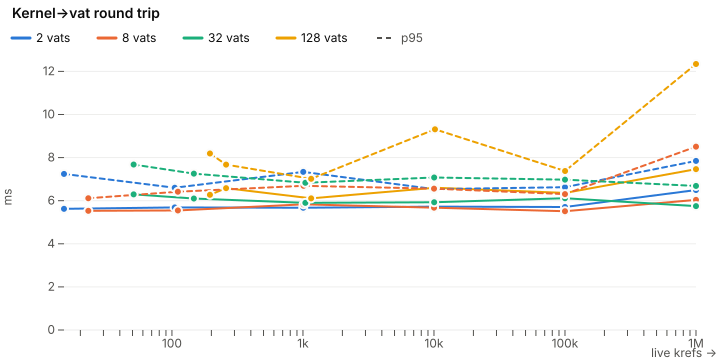
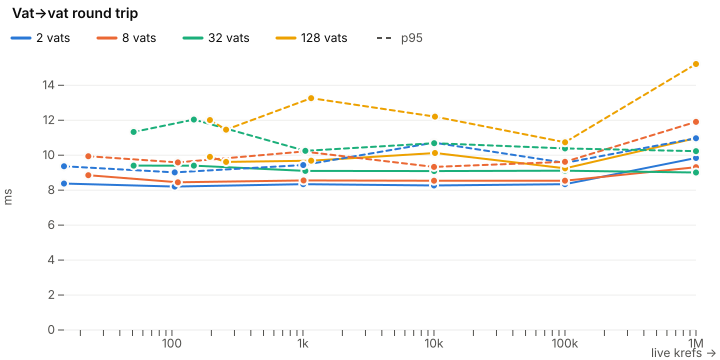
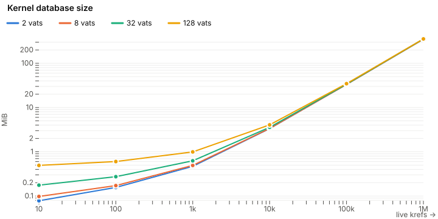
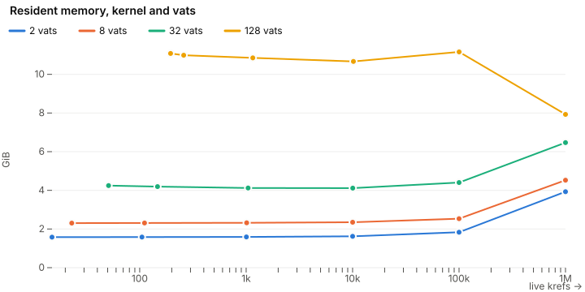
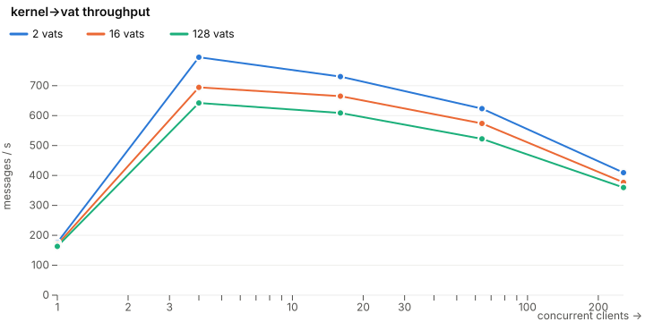
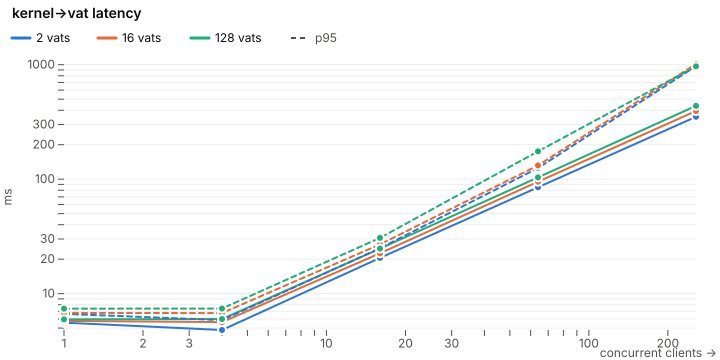
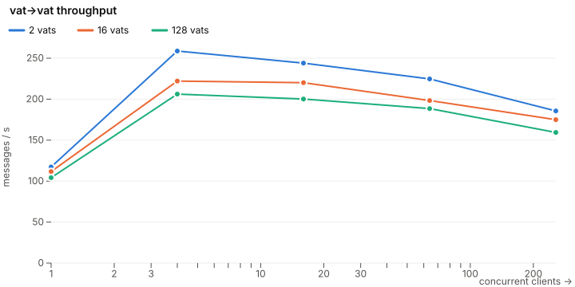
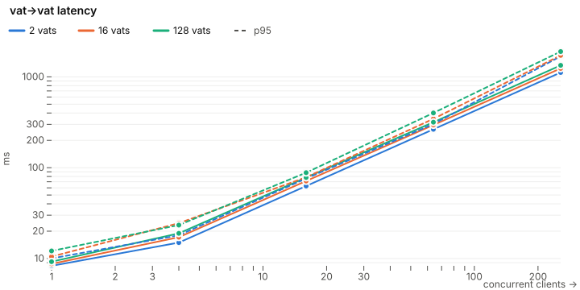
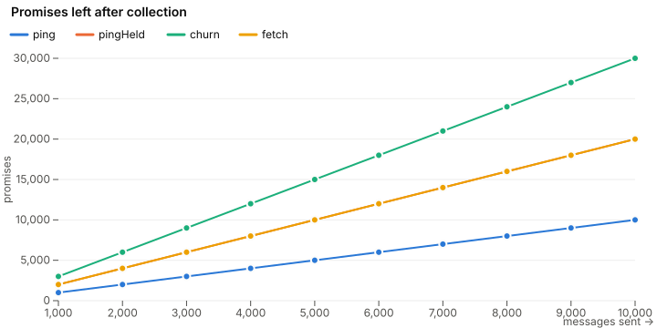
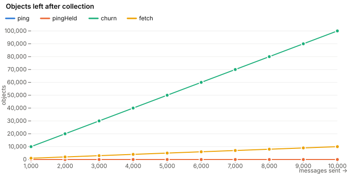

# Kernel performance

Run `2026-10-26T14-46-00.215Z` on Apple M3 Pro (12 cores, 36.00 GiB), darwin 27.0.0, Node v22.20.0, sqlite (nodejs, file).

## Delivery against live krefs

One message at a time, to holder vats whose c-lists hold the krefs. Solid lines are p50, dashed p95.

| vats |     krefs | db MiB | rss GiB | kernel→vat p50 ms |   p95 | vat→vat p50 ms |   p95 |
| ---- | --------: | -----: | ------: | ----------------: | ----: | -------------: | ----: |
| 2    | 1,000,005 |  352.0 |    3.93 |              6.49 |  7.85 |           9.84 | 10.97 |
| 8    | 1,000,011 |  350.3 |    4.52 |              6.04 |  8.51 |           9.31 | 11.91 |
| 32   | 1,000,035 |  353.2 |    6.47 |              5.75 |  6.68 |           9.01 | 10.23 |
| 128  | 1,000,131 |  355.0 |    7.93 |              7.46 | 12.34 |          10.98 | 15.22 |

## Concurrent load

100,000 live krefs. Each client sends its next message when its last is answered.

| vats | route      | peak msgs/s at clients | msgs/s at most clients | p50 ms there | p95 ms there |
| ---- | ---------- | ---------------------: | ---------------------: | -----------: | -----------: |
| 2    | kernel→vat |               795 at 4 |             409 at 256 |        350.9 |        971.0 |
| 2    | vat→vat    |               259 at 4 |             186 at 256 |       1117.6 |       1685.6 |
| 16   | kernel→vat |               694 at 4 |             377 at 256 |        394.1 |       1014.2 |
| 16   | vat→vat    |               222 at 4 |             175 at 256 |       1238.9 |       1724.0 |
| 128  | kernel→vat |               642 at 4 |             360 at 256 |        437.2 |        968.1 |
| 128  | vat→vat    |               206 at 4 |             159 at 256 |       1339.0 |       1899.1 |

## Garbage collection under load

Rounds of one workload at a time over 4 holder/minter pairs holding 10,000 krefs, 16 clients at once, with every vat reaped after each round. What remains above the pre-load baseline after collection, discounting what collecting itself leaves:

| workload | messages | objects / message | promises / message | c-list rows / message | vatstore rows / message |
| -------- | -------: | ----------------: | -----------------: | --------------------: | ----------------------: |
| ping     |   10,000 |              0.00 |               1.00 |                  2.00 |                    0.00 |
| pingHeld |   10,000 |              0.00 |               2.00 |                  6.00 |                    0.00 |
| churn    |   10,000 |             10.00 |               3.00 |                 30.00 |                    0.00 |
| fetch    |   10,000 |              1.00 |               2.00 |                  8.00 |                    0.00 |
